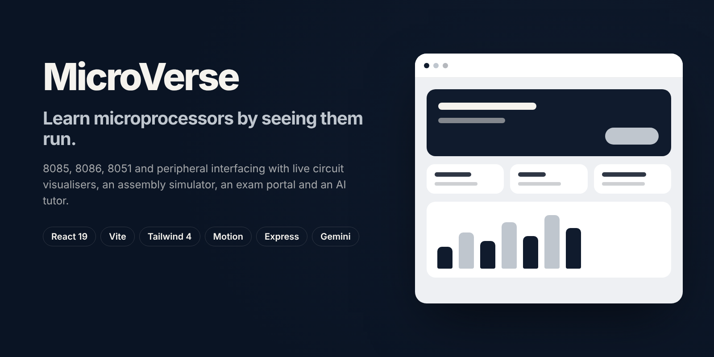
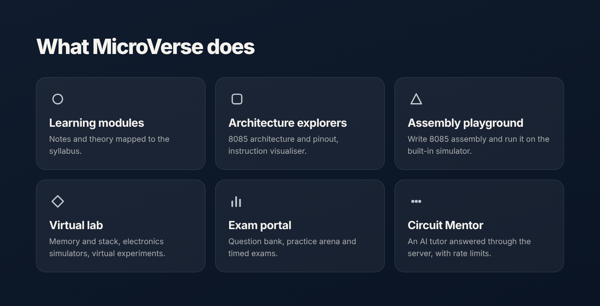
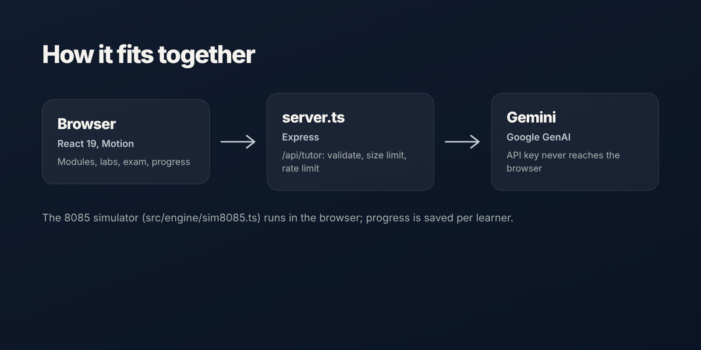

# MicroVerse



An interactive lab for learning microprocessors and microcontrollers: 8085, 8086, 8051 and peripheral interfacing, with live circuit visualisers, an assembly simulator, an exam portal and an AI tutor.

**Stack:** React 19, Vite, Tailwind CSS 4, Motion, Express, Google Gemini.



## Features

- Learning modules and notes for the syllabus
- 8085 architecture and pinout explorers, instruction visualiser
- 8085 assembly playground backed by a simulator (`src/engine/sim8085.ts`)
- Virtual lab: memory and stack, electronics simulators, virtual experiments
- Question bank, practice arena and exam portal
- Progress tracking across sessions
- Circuit Mentor: an AI tutor that answers through the server (the API key never reaches the browser)

## Run it locally

```bash
npm install
cp .env.example .env     # add your GEMINI_API_KEY
npm run dev              # http://localhost:3000
```

Other scripts: `npm run build`, `npm run preview`, `npm run lint`.

## Environment variables

| Variable | Purpose |
|---|---|
| `GEMINI_API_KEY` | Powers the AI tutor. Server-side only. |
| `APP_URL` | Hosted URL |
| `TUTOR_RATE_MAX` | Optional. Tutor questions per visitor per 10 minutes (default 20) |
| `TUTOR_DAILY_MAX` | Optional. Tutor questions per day for the whole site (default 500) |

## Security

The tutor endpoint (`POST /api/tutor`) validates input, limits request size, rate-limits per visitor and per day, and returns safe error messages. `vercel.json` sets security headers for static hosting.

## How it fits together



## Layout

```
server.ts                 Express server and /api/tutor, /api/health
src/components            Modules, labs, visuals, exam, tutor, dashboard
src/data                  Modules, notes, questions, syllabus theory
src/engine/sim8085.ts     8085 simulator
src/context               Progress state
```

---

The images in `docs/` are overview graphics, not screenshots. Replace them with real screenshots of the running app whenever you like (keep the same file names).
